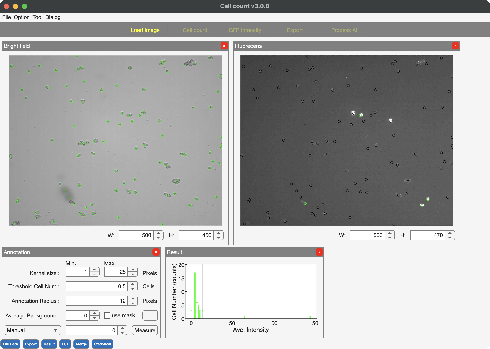
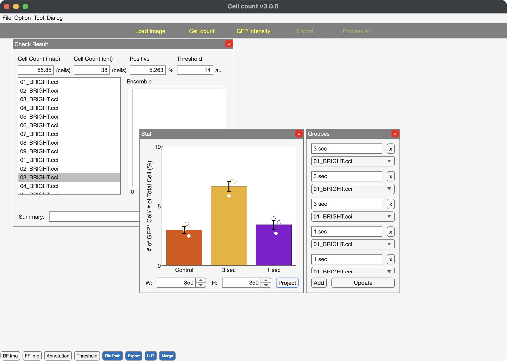
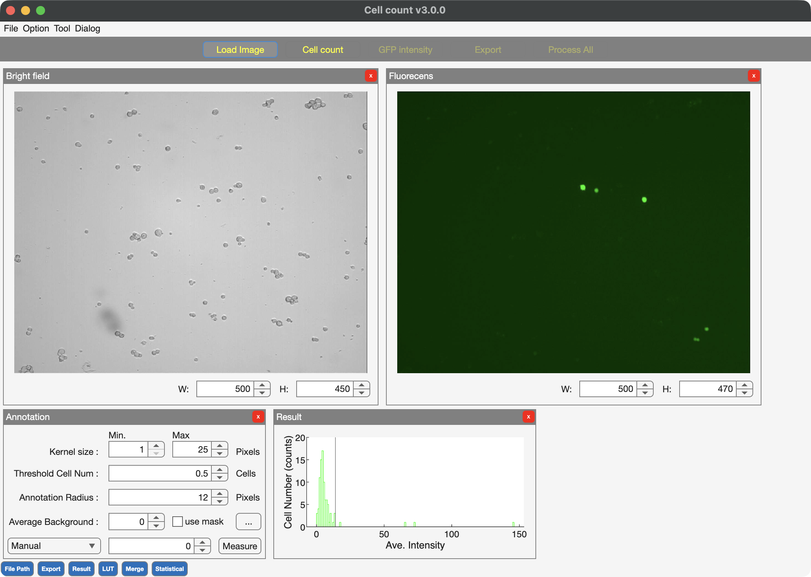

# CellCounter-DensityMap

**From cell images to fluorescence measurements, statistical tests, and figures.**

Load **BF images, density maps, and FP images** into one GUI. Locate cells, review fluorescence-positive cells, compare experimental groups, and create figures from the results.

**[Download for Windows](downloads/windows/v3r1b1/CellCounter_v3r1b1_installer.exe?raw=true)** · **[Download for Mac (Apple Silicon)](downloads/macos/v3r1b1/CellCounter_v3r1b1-installer-macOS-AppleSilicon.zip?raw=true)**

Review cell positions alongside BF and FP images, adjust fluorescence classification, and carry the results into group comparisons and figures within the same interface. Density maps are generated separately.

*Cell positions on the BF image and fluorescence classification on the FP image. Screenshots show the v3.0 interface.*

## Download the GUI

### Windows

| Choose a download | File |
| --- | --- |
| **First installation** | **[Download Windows installer](downloads/windows/v3r1b1/CellCounter_v3r1b1_installer.exe?raw=true)** |
| Runtime R2024b already installed | [Download application executable](downloads/windows/v3r1b1/CellCounter_v3r1b1.exe?raw=true) |

Version: **v3r1b1** · Windows x64 · MATLAB Runtime **R2024b**. The installer needs internet access to obtain Runtime. MATLAB itself is not required to use the GUI.

[Installation and usage](downloads/windows/v3r1b1/README.md) · [SHA-256 checksums](downloads/windows/v3r1b1/SHA256SUMS.txt)

### macOS — Apple Silicon

| Choose a download | File |
| --- | --- |
| **First installation** | **[Download Mac installer ZIP](downloads/macos/v3r1b1/CellCounter_v3r1b1-installer-macOS-AppleSilicon.zip?raw=true)** |
| Compatible Runtime already installed | [Download Mac application ZIP](downloads/macos/v3r1b1/CellCounter_v3r1b1-macOS-AppleSilicon.zip?raw=true) |

Version: **v3r1b1** · **Apple Silicon (arm64)** · MATLAB Runtime **R2024b Update 10**. Extract the ZIP on your Mac before opening the app. Intel Mac binaries are not supplied.

[Mac installation and usage](downloads/macos/v3r1b1/README.md) · [SHA-256 checksums](downloads/macos/v3r1b1/SHA256SUMS.txt)

## From images to figures

1. **Load your images.** Select the BF image, density map, and matching FP image; check alignment and analysis settings.
2. **Locate cells and measure fluorescence.** Review the detected positions, adjust the fluorescence threshold, and export coordinates and measurement tables. Batch processing applies the workflow to multiple image sets.
3. **Compare groups and plot results.** Group the results, run statistical tests, and generate figures with individual data points and summary statistics.

*Group comparison and figure generation in the GUI. Example screenshot from v3.0.*

Image loading and analysis controls

## License and GUI distribution

The source code and documentation distributed in this repository are provided under the [MIT License](LICENSE). External MATLAB products retain their own terms; see [THIRD_PARTY_NOTICES.md](THIRD_PARTY_NOTICES.md).

GUI binaries are free to use; modification and redistribution require prior permission. See [GUI usage terms](downloads/windows/v3r1b1/GUI_LICENSE.md). The MIT license applies to the published analysis source and documentation, excluding those GUI binaries. The separate CellCounter GUI source is not part of this distribution. This repository's MIT license does not grant rights to excluded GUI code. The supplied GUI executables have separate dependency notices in [GUI dependency notes](downloads/windows/v3r1b1/THIRD_PARTY_NOTICES.txt); see [Windows GUI instructions](downloads/windows/v3r1b1/README.md) for scope and verification limits.

## Associated paper

Ryuto Shinozaki, Rika Numano. Training-free interpretation of count-calibrated density maps for label-free cell localization. *Japanese Journal of Applied Physics*. 2026. [doi:10.35848/1347-4065/aeb94f](https://doi.org/10.35848/1347-4065/aeb94f).

## Reference

[1] Ryuto Shinozaki, Rika Numano. *CellCounter-DensityMap*. 2026. [GitHub](https://github.com/Numano-Laboratory/CellCounter-DensityMap).
